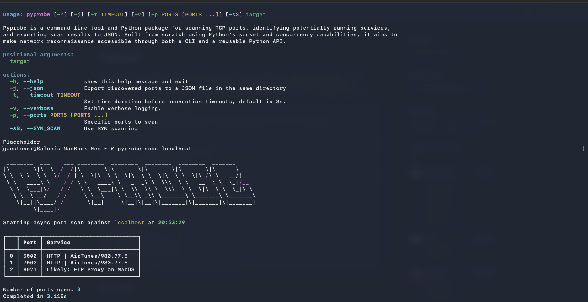
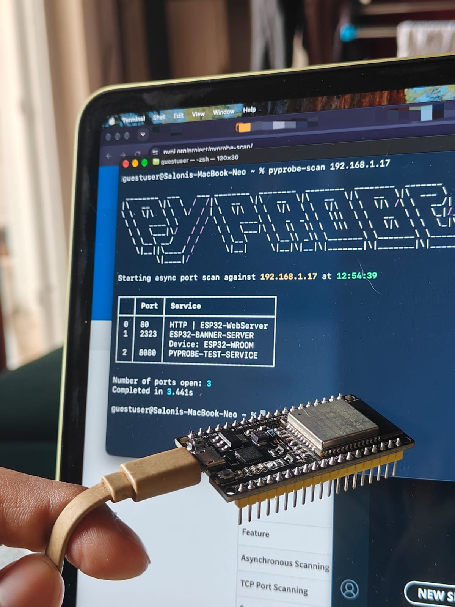

# Pyprobe

[](https://pepy.tech/projects/pyprobe-scan)

Pyprobe is a command-line tool and Python package for scanning TCP ports, identifying potentially running services, and exporting scan results to JSON. Built from scratch using Python's socket and concurrency capabilities, it aims to make network reconnaissance accessible through both a CLI and a reusable Python API.

</img>

## Features

| Feature | Description |
|---|---|
| **Asynchronous Scanning** | Uses `asyncio` and `asyncio.to_thread()` to scan multiple ports concurrently. |
| **TCP Port Scanning** | Identifies accessible TCP ports on a target host. |
| **Service Detection** | Attempts to identify services using port mappings and service signatures. |
| **Terminal Output** | Displays scan results in a formatted table using Rich. Use `-v` for verbose logging. |
| **JSON Export** | Saves discovered ports and service information to a JSON file. |
| **Specific Port Scanning** | Scan specific ports on the target with `-p` |
| **Custom Timeouts** | Set a custom timeout for each TCP connection |
| **CLI and Python API** | Designed for terminal use and integration into Python programs. |
| **SYN Scanning** | Use SYN scanning for port discovery with `-sS` |

## Installation

Install from PyPI

install it with:

```bash
pip install pyprobe-scan
```

Install from source

Clone the repository:

```bash 
git clone https://github.com/fourtysevencode/pyprobe.git
cd pyprobe
```

Create and activate a virtual environment:

```bash
python3 -m venv .venv
source .venv/bin/activate
```

Install the project in editable mode:

```bash
python -m pip install -e .
```

## Project Structure
```
pyprobe
├── dist/
│   ├── pyprobe_scan-0.1.6-py3-none-any.whl
│   └── pyprobe_scan-0.1.6.tar.gz
├── docs/
│   ├── demo-screenshots/
│   │   └── dummy-help-scan.png
│   └── ESP_Demo/
│       └── pic.jpeg
├── src/
│   └── pyprobe/
│       ├── services/
│       │   ├── __init__.py
│       │   ├── common_service_signatures.py
│       │   ├── commonly_used_ports.py
│       │   ├── find_service.py
│       │   ├── scan_port.py
│       │   └── syn_scan.py
│       ├── __init__.py
│       ├── __main__.py
│       ├── cli_args.py
│       ├── cli.py
│       ├── output.py
│       └── scanner.py
├── tests/
│   ├── Dummy_ESP32_Server/
│   │   └── Dummy_ESP32_Server.ino
│   └── package_tests/
│       └── test_scan.py
├── .gitignore
├── pyproject.toml
└── README.md

```

## Usage

Display help

```bash
pyprobe-scan --help
```

Scan a target

```bash
pyprobe-scan 127.0.0.1
```

Replace 127.0.0.1 with the IP address of a host you own or have explicit permission to test.

Export results to JSON

```bash
pyprobe-scan 127.0.0.1 --json
```

The short form is also available (applicable to all commands use -h to view):

```bash
pyprobe-scan 127.0.0.1 -j
```

The scan results are saved to a timestamped JSON file in the current working directory.

Enable verbose logging:

```bash
pyprobe-scan 127.0.0.1 -v
```

Set a timeout on each TCP connection:

```bash
pyprobe-scan 127.0.0.1 -t 3 # Default is 3s
```

Scan specific ports on the server

```bash
pyprobe-scan 127.0.0.1 -p 80 443 # Scans port 80 and 443
```

Use SYN scanning

```bash
sudo pyprobe-scan 127.0.0.1 -sS
```
Requires elevated permissions

## Contributing

Feel free to point out any problems, potential problems or suggestions by creating an issue here. PRs are welcome as well as long as they document the changes made, features added along with how they function sufficiently.

Usage of AI coding agents to create automated PRs is discouraged but you are free to use AI to learn how the codebase works and write the code yourself. 

### Run directly from source

If you haven't installed the package yet, run it from the repository root:

```bash
PYTHONPATH=src python -m pyprobe 127.0.0.1
```

## Using Pyprobe in Python

Pyprobe is also designed to be imported into your own Python projects.

```python
import asyncio
from pyprobe.scanner import scan

async def main():
    results = await scan("127.0.0.1")
    print(results)

asyncio.run(main())
```

The scanner returns a pandas DataFrame containing discovered ports and their detected service information.

You can process the results using pandas:

```python
results = asyncio.run(scan("127.0.0.1"))

print(results)
print(f"Open ports found: {len(results)}")
```

## Testing
If you don't have a server to run test scans against, you may use the ESP32 sketch in `tests/Dummy_ESP32_Server' to host one on your ESP32.

Replace the hyphens with your WiFi network's SSID and password, and get it's local IP from your serial monitor.

```c++
const char* ssid = "-";
const char* password = "-";
```

You will get the following output:

</img>

_the tiny hair is from my dog Maple, who is snuggled up beside me as I write this_

## Contact

If you have any questions, feedback or anything else, feel free to reachout!

[Discord](https://discord.com/users/1388765935996895284), [Website](https://ronakbuilds.tech/)

## Credits

Shipped to [Hack Club Crescent](https://crescent.hackclub.com) 2026

This project was written with almost no help from generative AI (part of my personal AI Detox)


_made with 💗 from fourtysevencode_
